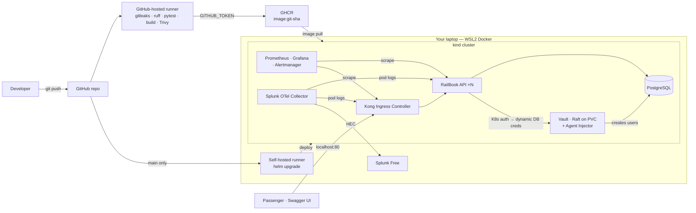

# RailBook — Product Requirements Document

**Status:** In progress — see [STATUS.md](STATUS.md) · **Date:** 2026-10-20 · **Timebox:** 1 day (~8 hours) · **Runs on:** your laptop only (WSL2 + kind)

---

## 1. Overview

RailBook is a minimal train ticket booking API, built in **one day** to learn four concepts by building them: **CI/CD, Prometheus metrics, Splunk logs and Vault secrets**. Everything runs on your own machine in a local Kubernetes cluster (kind); there is no cloud deployment. The project ends when the day ends. The booking domain is deliberately tiny, and anything that doesn't teach those concepts is out of scope.

**All four concepts are mandatory and are built in full as specified.** No shortcuts or fallbacks to save time (§5).

Everything runs on your machine:

```
RailBook (kind)
  ├── Traffic ──────> Kong Gateway ──> API pods ──> Postgres
  ├── Metrics ──────> Prometheus ──> Grafana        (in kind)
  ├── Logs ─────────> Splunk                        (Docker, next to kind)
  └── Secrets ──────> HashiCorp Vault               (in kind)
```

The app is built as a **[Twelve-Factor App](https://12factor.net/)**. The twelve factors are the design rules that make the four concepts fit together: logs as streams (Splunk), config and secrets from the environment (Vault), build-release-run (CI/CD), and stateless processes that scale by count (Prometheus). **Kong Gateway** is the single entry point and router in front of the API. §3.3 maps each factor to how RailBook meets it.

### Done when

1. A `git push` to `main` tests, builds and scans the image on GitHub, then the self-hosted runner deploys it to kind with no manual steps.
2. The API gets every secret from Vault — none in code, image, Helm values or GitHub.
3. Grafana shows gateway metrics (Kong) and app metrics (API): rate, errors, latency, bookings.
4. Splunk shows logs from Kong and the API, and one search by `request_id` follows a request through both.
5. Hitting the rate limit on `POST /bookings` shows up as 429s in Grafana and Splunk.
6. Every row of the Twelve-Factor checklist (§3.3) can be shown in the code or the running system.

---

## 2. User types and user stories

### 2.1 Passenger

| ID | User story | Acceptance criteria |
|---|---|---|
| P1 | As a passenger, I want to search trains between two stations on a date. | Returns trains with seats available per class. |
| P2 | As a passenger, I want to book seats. | Returns a PNR; booking fails cleanly if not enough seats; no double booking. |
| P3 | As a passenger, I want to look up and cancel a booking by PNR. | Cancel returns seats to inventory. |

All passenger traffic enters through Kong at `http://127.0.0.1` — the web frontend at `/`, or the API directly.

### 2.2 Developer

| ID | User story | Acceptance criteria |
|---|---|---|
| D1 | As a developer, I want every pull request checked automatically. | GitHub-hosted runner: gitleaks, ruff, pytest, Docker build + Trivy scan. |
| D2 | As a developer, I want a push to `main` to deploy automatically. | Image pushed to GHCR tagged with the git SHA; self-hosted runner runs `helm upgrade` on kind and waits for rollout. |
| D3 | As a developer, I want no stored credentials in CI. | GHCR push uses the built-in `GITHUB_TOKEN`; kind pulls the public image with no credentials. |
| D4 | As a developer, I want to roll back a bad release. | `helm rollback railbook` restores the previous revision. |

### 2.3 SRE / on-call

| ID | User story | Acceptance criteria |
|---|---|---|
| S1 | As an SRE, I want rate, errors and latency per route, at the gateway and in the app. | Grafana dashboard with a Kong panel group and an API panel group. |
| S2 | As an SRE, I want a bookings counter. | `bookings_total{status}` visible in Prometheus. |
| S3 | As an SRE, I want one alert. | Alert on high 5xx rate fires when triggered on purpose, visible in Alertmanager. |
| S4 | As an SRE, I want to follow one request end to end. | Kong adds `X-Request-ID`; the API logs it; Splunk search by `request_id` returns the Kong and API lines. |

### 2.4 Security admin

| ID | User story | Acceptance criteria |
|---|---|---|
| X1 | As a security admin, I want the DB password to come from Vault. | Vault database engine issues a Postgres user per pod; delivered by the Vault Agent Injector. |
| X2 | As a security admin, I want static secrets in Vault too. | Mock payment API key and Splunk HEC token stored in Vault KV v2. |
| X3 | As a security admin, I want the self-hosted runner to be safe on a public repo. | Safeguards in §6.6 are in place. |

---

## 3. Key features

### 3.1 Application

| # | Feature | Notes |
|---|---|---|
| F1 | Seeded stations, trains and schedules | Seed runs as a Kubernetes Job; no admin endpoints. |
| F2 | `GET /trains?from=&to=&date=` | Search with seats left per class. |
| F3 | `POST /bookings` | `SELECT … FOR UPDATE` on inventory; generates PNR; mock payment step using the payment key from Vault. |
| F4 | `GET /bookings/{pnr}`, `DELETE /bookings/{pnr}` | Lookup and cancel. |
| F5 | `/metrics`, `/healthz`, `/readyz` | Prometheus endpoint + Kubernetes probes. |
| F6 | JSON logs to stdout | `request_id` (from Kong's header), `pnr`, `path`, `status`, `duration_ms`. |
| F7 | Web frontend at `/` | Static HTML + JS + CSS in `app/static/`, served by the API from the same image (same origin, no CORS). Search, book, PNR lookup, cancel; shows each response's `X-Request-ID`; handles 402/409/429. No external scripts or fonts. |
| F8 | `GET /stations` | Station list for the frontend's dropdowns. |
| F9 | Swagger UI at `/docs` | API docs. |

No user accounts: the passenger name is a field on the booking.

### 3.2 Platform

| # | Area | Feature |
|---|---|---|
| K1 | Cluster | Single-node kind cluster with port 80 mapped to Kong's proxy. Defined in `kind-config.yaml` in the repo. |
| G1 | Gateway | **Kong Ingress Controller** (DB-less) via Helm. Routes `/trains`, `/bookings`, `/docs` to the API Service. |
| G2 | Gateway | Kong plugins as `KongPlugin` resources: `correlation-id` (`X-Request-ID`), `prometheus`, `rate-limiting` on `POST /bookings`. |
| C1 | CI | On PR (GitHub-hosted runner): `gitleaks`, `ruff`, `pytest` against a Postgres service container, Docker build, Trivy scan. |
| C2 | CI | On push to `main` (GitHub-hosted): same checks, then push image to **GHCR** tagged with the git SHA. Actions pinned by commit SHA, tool images by digest, `GITHUB_TOKEN` read-only except `packages: write` in the image job. |
| C3 | CD | On push to `main` (**self-hosted runner** `railbook-laptop`, user `ghrunner`, systemd service): `helm upgrade --install --rollback-on-failure --wait --wait-for-jobs` with that tag; setup Job; smoke test through Kong. Runs as the `github-deployer` service account (namespace `railbook` only, 24 h token). |
| M1 | Metrics | `kube-prometheus-stack` (Prometheus, Grafana, Alertmanager) via Helm. |
| M2 | Metrics | ServiceMonitors for the API and Kong. |
| M3 | Metrics | One Grafana dashboard (gateway + app) and one alert rule (5xx rate). |
| L1 | Logs | Splunk Free in Docker on your laptop, attached to the `kind` Docker network, HEC enabled. |
| L2 | Logs | Splunk OTel Collector for Kubernetes (Helm) → Splunk HEC. Only the `railbook` and `kong` namespaces. |
| L3 | Logs | Saved searches: errors by route, one request by `request_id`, 429s from rate limiting. |
| V1 | Secrets | Vault server with persistent Raft storage (Helm, 1 replica), initialised and unsealed by `scripts/vault-unseal.sh` (5 key shares, threshold 3; keys in `~/.railbook/`, outside the repo). Kubernetes auth method, Agent Injector. |
| V2 | Secrets | Vault database secrets engine → a unique, short-lived Postgres user per API pod (1 h lease, renewed by the agent sidecar, 24 h max). |
| V3 | Secrets | Vault KV v2 → Postgres admin password, mock payment key, Splunk HEC token. **No Kubernetes Secrets hold application secrets.** |
| V4 | Secrets | Vault configuration as a re-runnable script in the repo (`scripts/vault-setup.sh base` before Postgres, `database` after). |

### 3.3 Twelve-Factor checklist

| # | Factor | How RailBook meets it | How to show it |
|---|---|---|---|
| I | Codebase | One public Git repo holds the app, Helm chart, Kong config and pipeline. | One repo; every deploy comes from it. |
| II | Dependencies | All Python dependencies declared and pinned in a lockfile (`uv.lock` or `requirements.txt` with hashes); slim base image, no reliance on system tools. | Clean `docker build` from scratch works in CI. |
| III | Config | Everything environment-specific is read from environment variables via `pydantic-settings`. Non-secret config from a ConfigMap; secrets rendered by Vault Agent (§6.7). No config in code. | `grep` finds no hostnames or passwords in code. |
| IV | Backing services | Postgres and Vault are attached resources addressed by URL in config. Swapping one is a config change. | Tests in CI use a different Postgres URL with the same code. |
| V | Build, release, run | **Build:** CI builds one image per commit, tagged with the git SHA, pushed to GHCR. **Release:** that image + Helm values = a Helm revision. **Run:** pods in kind. The image is never rebuilt after build. | Image digest running in kind = digest built by CI; `helm history` lists releases. |
| VI | Processes | API is stateless: no in-memory sessions, caches or local files; all state in Postgres. | Delete a pod mid-traffic; no data lost. |
| VII | Port binding | Uvicorn binds to `$PORT`; the app is self-contained. Kong routes to that port. | Change `PORT` in the ConfigMap; Service and Kong still route. |
| VIII | Concurrency | Scale by adding pods, one Uvicorn worker per pod; Kong load-balances them. | `kubectl scale deploy/railbook-api --replicas=3`; Grafana shows 3 targets. |
| IX | Disposability | Starts in seconds; handles `SIGTERM` gracefully (finish in-flight requests, close DB pool); readiness probe gates traffic. | `kubectl rollout restart` under load with zero failed requests. |
| X | Dev/prod parity | Same image, same Postgres 16 and same Vault in CI tests and in kind. | Same tests pass in CI and as a smoke test in kind. |
| XI | Logs | API and Kong write JSON events to stdout only. The platform (OTel Collector) routes them to Splunk. | No log files in the container; no Splunk code in the app. |
| XII | Admin processes | Seed data runs as a one-off Kubernetes Job using the same image and config as the API. | `kubectl get jobs -n railbook` shows the seed Job. |

---

## 4. Tech stack

| Layer | Choice | Notes |
|---|---|---|
| Language / framework | **Python 3.12 + FastAPI** | `prometheus-fastapi-instrumentator`, `structlog`, `pydantic-settings`. |
| Database | **PostgreSQL 16** (official image) as a StatefulSet in its **own Helm chart** (`deploy/charts/postgres`), installed before the app; admin password from Vault | Tables created by the admin Job (`python -m app.admin setup`), owned by a `railbook_owner` group role so they never belong to an expiring Vault user — no Alembic. |
| ORM | SQLAlchemy 2.x | |
| Tests | pytest + httpx | |
| Cluster | **kind** (Kubernetes in Docker), single node, in WSL2 | `kind-config.yaml` with port 80 mapping. |
| Gateway | **Kong Ingress Controller** (open-source Kong Gateway, DB-less) | Configured with Ingress + `KongPlugin` resources. |
| Packaging | Helm 4.3 | Own charts: `railbook` (API, routing, setup Job) and `postgres`; upstream charts for Kong, Vault, Prometheus, OTel. The pipeline deploys only the app chart. |
| Tooling versions | kind v0.33.0, Helm v4.3.0, kubectl v1.36 | Installed in `~/.local/bin`. |
| Image registry | **GitHub Container Registry (GHCR)** | Free for public repos; package set to public. |
| CI | GitHub Actions on GitHub-hosted runners | PRs and `main`. |
| CD | GitHub Actions **self-hosted runner** in WSL | `main` only. |
| Metrics | `kube-prometheus-stack` | |
| Logs | Splunk Enterprise (Free license) in Docker + Splunk OTel Collector for Kubernetes | Splunk lives outside kind, so rebuilding the cluster keeps logs. |
| Secrets | **HashiCorp Vault** 2.0 (chart 0.34.1), persistent Raft storage + Agent Injector | Runs in kind; manual unseal by script after restarts. |
| Security scans | gitleaks, Trivy | |

### Architecture



---

## 5. Day plan

| # | Block | Time | Output |
|---|---|---|---|
| 0 | Setup | 0:30 | kind + Helm installed, public GitHub repo, `.gitignore`, runner user created. |
| 1 | App | 1:45 | FastAPI endpoints, env-based config, graceful shutdown, seed script, metrics, JSON logs, tests, Dockerfile — Twelve-Factor from the start. |
| 2 | kind + Kong + Vault | 2:00 | Cluster; Kong routing + plugins; Vault init/unseal/config; Postgres chart; app chart with all secrets from Vault. |
| 3 | CI/CD | 1:30 | PR and `main` workflows; GHCR push; self-hosted runner registered and deploying the app chart; branch protection. |
| 4 | Prometheus + Grafana | 0:45 | `kube-prometheus-stack`, ServiceMonitors for API and Kong, dashboard, alert. |
| 5 | Splunk | 0:45 | Splunk on the `kind` network, OTel Collector, saved searches. |
| 6 | Verify | 0:45 | Run the six "done when" checks and the Twelve-Factor "how to show it" column. |
| | **Total** | **~8:00** | |

If running late, the day runs longer — nothing is cut. Building every piece, including where it gets stuck, is the point of the project.

---

## 6. Pitfalls and considerations

### 6.1 kind on WSL2

- **Memory: fixed at 8 GB.** WSL (and Docker Desktop inside it) stays at its 8 GB default; `.wslconfig` is not changed. Everything must fit a budget, enforced with memory limits in Helm values and Docker:

  | Component | Budget |
  |---|---|
  | kind node (API server, etcd, kubelet…) | ~1.2 GB |
  | Splunk (container `--memory=2g`) | 2.0 GB |
  | kube-prometheus-stack (Prometheus capped at 512 MB, 1-day retention) | ~0.9 GB |
  | Kong (proxy + controller) | ~0.3 GB |
  | Vault + injector | ~0.2 GB |
  | Postgres + API ×2 | ~0.4 GB |
  | Splunk OTel Collector (agent only, cluster receiver off) | ~0.2 GB |
  | Self-hosted runner | ~0.2 GB |
  | **Total** | **~5.4 GB**, leaving ~2.5 GB for WSL, Docker and image builds |

  Scale the API to 3 replicas only to demonstrate factor VIII, then back to 2. If pods get `OOMKilled` or stay `Pending`, check `kubectl top` and the budget before anything else.
- **Single node.** Use one control-plane node only; a multi-node cluster costs ~1 GB per node and teaches nothing extra here.
- **Port mapping is fixed at creation.** Port 80 must be in `extraPortMappings` in `kind-config.yaml` before `kind create cluster`; adding it later means recreating the cluster.
- **"Too many open files".** A known kind issue on Linux. Raise `fs.inotify.max_user_watches` and `fs.inotify.max_user_instances` with `sysctl` before creating the cluster.
- **Restarts.** kind usually survives a WSL restart, but not always. Vault comes back **sealed** after any restart: run `scripts/vault-unseal.sh`, and pods that start meanwhile wait in `Init` until it's unsealed. Everything is re-creatable from the repo with `scripts/bootstrap.sh`.
- **Project location.** `/mnt/d` is slow from WSL. Moving the repo to `~/projects/railbook` makes builds and Git noticeably faster.

### 6.2 Kong Ingress Controller

- **DB-less, configured by Kubernetes resources.** Routes come from `Ingress` (or Gateway API `HTTPRoute`), plugins from `KongPlugin` resources attached by annotation. There is no `kong.yml` to edit and no Admin API writes. That is Twelve-Factor-friendly: all config is in Git.
- **Use Ingress, not Gateway API, for the day.** Gateway API needs its CRDs installed and adds more resource types. Ingress is enough to learn routing and plugins.
- **Prometheus plugin needs two switches.** The `prometheus` KongPlugin enables metrics, and the Helm chart's ServiceMonitor must be enabled with the right release label (§6.4), or Prometheus never scrapes Kong.
- **Correlation ID.** Configure `correlation-id` with `header_name: X-Request-ID` and `echo_downstream: true`; the API must read that header rather than generating its own ID.
- **Rate limiting.** Use `policy: local` (no Redis). With several Kong pods each pod counts separately; with one Kong pod it's exact.
- **No direct Vault support.** Open-source Kong can't read secrets from HashiCorp Vault (an Enterprise feature). Kong needs no secrets in this design, so keep it that way.
- **Pin versions.** Pin the Helm chart and Kong image versions in the repo so a rebuild gives the same result.

### 6.3 Vault

- **Persistent, not dev mode.** Dev mode keeps data in memory: a restart would wipe the Postgres admin password while Postgres keeps the old one on disk, locking everyone out. Raft storage on a PVC avoids that, at the cost of init + unseal.
- **Secret zero.** Unseal keys and the root token can't live in Vault. They are in `~/.railbook/vault-init.json` (`chmod 600`, outside the repo). Losing it makes Vault's data unrecoverable; leaking it opens Vault.
- **Bring-up order matters:** Vault → unseal → `vault-setup.sh base` → Postgres chart → `vault-setup.sh database` → app chart. API pods started before the database engine is configured hang in `Init`.
- **Jobs and sidecars.** A Job completes only when all containers exit; the agent sidecar never exits. Jobs use `agent-pre-populate-only`.
- **Template whitespace.** In Vault Agent templates `{{-` trims the newline before it; misplaced, it glues `export` lines together and the shell fails to load the file.
- **Audience.** Roles check the token's `aud` claim (`https://kubernetes.default.svc.cluster.local` on kind) so tokens issued for other services are rejected.
- **Kubernetes auth.** Each Vault role is bound to one service account + namespace. A typo in either gives `permission denied` with little detail — check `vault read auth/kubernetes/role/<role>` first.
- **Database engine.** Vault connects to Postgres as an admin user to create short-lived users. Postgres must be up before `vault-setup.sh` runs, and the creation SQL must grant the right table privileges or the API gets `permission denied for table`.
- **TTL.** Credentials are read at startup (§6.7). The sidecar renews the 1 h lease up to the 24 h `max_ttl`; after that the pod must restart to pick up a new user. Pods that die without renewing (and the setup Job's user) are dropped by Vault within an hour.
- **HEC token for the OTel Collector.** Must come from Vault like every other secret. The collector image has no shell, so the env-file trick in §6.7 doesn't work for it; the delivery method is decided in block 6.
- **License.** Vault uses the Business Source License, free for learning and internal use.

### 6.4 Prometheus

- **ServiceMonitor label.** `kube-prometheus-stack` only picks up ServiceMonitors carrying its release label (e.g. `release: monitoring`) unless you set `serviceMonitorSelectorNilUsesHelmValues: false`. This is the most common "why isn't it scraping?" cause.
- **Red targets on kind.** Monitors for etcd, kube-scheduler, kube-controller-manager and kube-proxy show as down on kind because those bind to localhost. Disable them in the chart values.
- **Memory.** Lower retention to 1–2 days and scrape interval to 30 s.
- **Cardinality.** Label metrics by route template (`/bookings/{pnr}`), never by real PNRs or names.
- **Gateway vs app metrics.** Kong and the API both count requests. Keep them in separate, clearly labelled dashboard rows; the difference between them (e.g. 429s that never reach the API) is part of what you learn.

### 6.5 Splunk

- **Networking.** Run Splunk with `--network kind` so the kind node can reach it by container name (`splunk:8088`). Splunk then lives outside the cluster, so `kind delete cluster` doesn't lose logs or saved searches.
- **500 MB/day cap.** Filter the collector to the `railbook` and `kong` namespaces. Going over the cap repeatedly blocks search on the Free license.
- **Web UI exposure.** Splunk Free has no login. Publish port 8000 on `127.0.0.1` only.
- **TLS.** HEC uses a self-signed certificate by default. Set the collector's `insecureSkipVerify: true` — acceptable on a single machine.
- **Persistence.** Mount Docker volumes for `/opt/splunk/var` and `/opt/splunk/etc`.

### 6.6 CI/CD with a self-hosted runner on a public repo

- **The risk.** GitHub warns against self-hosted runners on public repos: anyone can open a pull request, and a workflow triggered by it could run their code on your laptop.
- **Safeguards (all required):**
  - Only the deploy job uses `runs-on: [self-hosted, kind]`, and it only triggers on `push` to `main`. PR checks always run on GitHub-hosted runners.
  - Repo setting: *Actions → Fork pull request workflows → Require approval for all outside collaborators*.
  - Branch protection on `main`: PRs required, checks must pass, no force pushes.
  - Runner runs as a dedicated non-admin WSL user, with access only to Docker and the kind kubeconfig.
  - Stop the runner service when not working on the project.
- **GHCR package visibility.** With the `org.opencontainers.image.source` label linking it to this public repo, the package came out **public** (verified with an anonymous pull). Without that link it would be private and kind would fail with `ImagePullBackOff`.
- **Kubeconfig for the runner.** Not kind's admin kubeconfig: a `github-deployer` service account limited to the `railbook` namespace, with a 24 h token from `kubectl create token` (`scripts/setup-runner.sh refresh-token`). Verified it can deploy but is forbidden from `vault`.
- **Merging is deploying.** With auto-deploy on `main`, the merge button is a production decision; Claude Code's auto mode won't press it.
- **Deploy safely.** Use `helm upgrade --install --rollback-on-failure --wait --timeout 5m` so a failed rollout rolls itself back. (Helm 4 renamed `--atomic` to `--rollback-on-failure`; many tutorials still show the old flag.)
- **Never `latest`.** Deploy by git SHA tag so you know exactly which build runs and rollback works.

### 6.7 Twelve-Factor

- **Config (III) vs Vault.** Twelve-Factor says config comes from environment variables. The Vault Agent Injector writes secrets to a **file** (`/vault/secrets/…`). Resolution: the agent template renders `export DB_USER=… DB_PASSWORD=…`, and the container command runs `. /vault/secrets/db && exec uvicorn …`. The app only reads env vars and knows nothing about Vault.
- **Consequence:** env vars are read once at startup, so a rotated DB credential needs a pod restart. That fits Disposability (IX).
- **Keep secrets out of plain env vars elsewhere.** Never put them in the ConfigMap, Helm values or workflow files; env vars show up in `kubectl describe`.
- **Logs (XI).** No Splunk handler in Python. The app writes to stdout; shipping is the platform's job.
- **Admin processes (XII).** The seed Job may run on every deploy. Make it idempotent (`INSERT … ON CONFLICT DO NOTHING`) and give each run a unique Job name (or delete the old Job first), since Jobs are immutable.
- **Port binding (VII) with Kong.** The API still binds its own port; Kong is a separate process routing to the Service, not a web server the app depends on.

### 6.8 Naming

- "IRCTC" is a real organisation's brand; use "RailBook" for the repo, images and anything public.

---

## 7. Out of scope

| Item | Why |
|---|---|
| Any cloud deployment (GKE, Artifact Registry, Cloud Logging) | Runs on your laptop only. |
| Multi-node cluster, HA for anything | Not needed to learn the concepts; costs RAM. |
| User accounts, login, roles | Not among the concepts. |
| Admin endpoints | Seed Job instead. |
| Real payments | Mock only. |
| Waitlist, RAC, Tatkal, seat maps | Domain complexity with no platform value. |
| Multiple environments (staging/prod) | One namespace. |
| TLS on Kong | Plain HTTP on `localhost`. |
| Kong Enterprise features, Kong Manager | Open-source Kong only. |
| Vault auto-unseal, HA (3+ replicas), TLS | One persistent Vault, unsealed by script. |
| Alembic migrations | Tables created by the admin Job. |
| GitOps (Argo CD), tracing, autoscaling, service mesh | Not among the concepts. |

---

## 8. Decisions log

| Date | Decision |
|---|---|
| 2026-10-20 | Python 3.12 + FastAPI |
| 2026-10-20 | Runs locally only; no cloud deployment |
| 2026-10-20 | Local Kubernetes with kind, single node |
| 2026-10-20 | Kong Ingress Controller (DB-less) as gateway/router |
| 2026-10-20 | CI on GitHub-hosted runners; CD via self-hosted runner, `main` only |
| 2026-10-20 | Images in GHCR (public), tagged with git SHA |
| 2026-10-20 | Public GitHub repo |
| 2026-10-20 | HashiCorp Vault in kind with persistent Raft storage (not dev mode) + Agent Injector; all secrets from Vault, no Kubernetes Secrets |
| 2026-10-20 | Postgres in its own Helm chart, installed before the app |
| 2026-10-20 | Quick web frontend: static files served by the API (same image, same origin) |
| 2026-10-20 | Local images tagged by content hash (`dev-<hash>`), never a fixed tag |
| 2026-10-20 | Runner deploys as least-privilege `github-deployer` (namespace-scoped, 24 h token); branch protection on `main` incl. admins |
| 2026-10-20 | Splunk Free in Docker on the `kind` network |
| 2026-10-20 | WSL memory stays at 8 GB; stack fits a memory budget (§6.1) |
| 2026-10-20 | App follows the Twelve-Factor methodology (§3.3) |
| 2026-10-20 | All four concepts built in full; no shortcuts |

No open questions.
